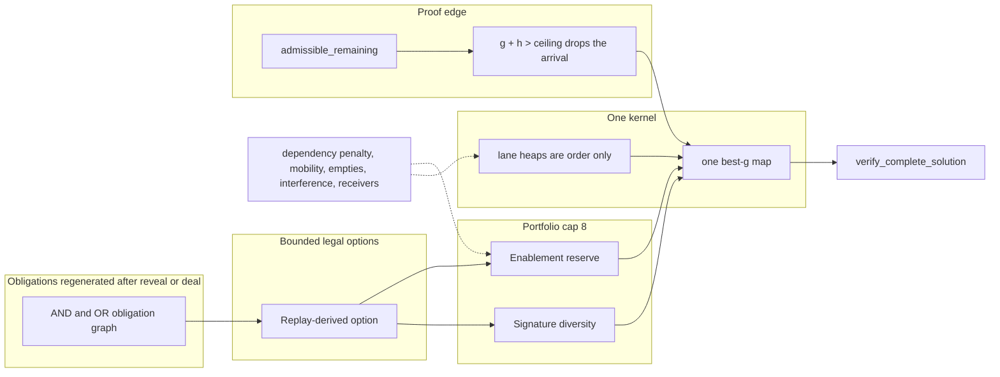

# Dependency-aware tactical options and long-horizon search

**Author:** design review (issue #17)  
**Date:** 2026-10-30  
**Status:** Reviewed — fixture corrected against SpiderState.can_move; implementation not authorized  
**Document type:** Design specification — not an implementation  
**Repository:** `Montgomerie-B/spider-solver` (local checkout `spider-play-lab-v0-103`)  
**Review branch:** `review/planning-architecture-post-v0-139`  
**Review commit:** `5691bcdf013a9620ea45f16635584459e72fa3d1`  
**Solver baseline:** `ef96d8e49450157c8c38ae2f41dc3f0f2202f3b5` (v0.139)  
**Issue:** [GitHub #17](https://github.com/Montgomerie-B/spider-solver/issues/17) — open, design and specification only  
**Review text validated:** `docs/planning_architecture_review_post_v0_139.md`

This document specifies how a later engineer implements dependency-aware options. It does not authorize that implementation, a v0.140 milestone, a budget increase, a search of deal 4925153, a change to verified solutions, or a merge to `main`.

Numeric claims in the Validation section are labeled **measured** or **inference**, with the file and symbol or section. Where the committed review or issue #17 disagrees with a source file, the file wins.

---

## Overview

The solver already generates legal primitives, costs them with corrected MobilityWare `step_cost`, prunes only when `g + admissible_remaining > ceiling` (equality stays eligible), and accepts a complete game only through `verify_complete_solution`. v0.134–v0.139 added short tactical terminals on one family of post-SD5 roots. Those terminals are observable properties. They do not record whether the path left the receiver, the buried card, and the workspace that the next manoeuvre needs.

The contract specified here is a replay-derived option plus a state-dependent AND/OR obligation graph. The portfolio prefers an option because that option makes a later obligation actionable and leaves its only receiver in place. A locally attractive action that destroys the only receiver of an OR-group of size 1 loses the first portfolio slot. When every outstanding receiver OR-group has size greater than 1, there is no reserve, and the higher-bond option may rank first. The losing action stays in `tableau_actions`. It is not proof-pruned. `dependency_penalty` orders candidates. It is never an argument to `lower_bound_fn`.

The single recommended first experiment, for later authorization, is a held-out synthetic two-stage unit test. It does not load deal 4925153, the 172 line, or the 185 line.

---

## Background and motivation

Deal `deals/4925153.txt` has two verified complete replays. `solutions/4925153_canonical.moves` is 174 explicit actions, corrected MobilityWare cost 172, eight foundations, SHA-256 `18338A08576AD24E9AF1F4BA2E7DB3E28768788DD511E823193B1937F3FEEF33` (**measured**, `docs/reveal_aware_heart_macros_v0_139.md` section 7). `solutions/4925153_autonomous_185.moves` is 189 explicit actions, corrected cost 185, eight foundations, SHA-256 `B19C56E957AC2666298A80118D54FF7FCA6C8114ED7D27590E2E98A017D4FB73` (**measured**, same section). Neither file is proved optimal. `independent_cold_complete` stays false for any route that imports a prefix or rejoins a checkpoint. Code actions are 0-based `(src, dst, k)`. Files print `move {src+1} {dst+1} {k}`.

v0.124 measured a cold `search_whole_game` at 80,000 identities and `COST_CEILING = 300` that finished with zero foundations (`docs/global_search_architecture_v0_124.md` sections 8 and 11). The adapter's function default `SEARCH_UNIQUE = 800_000` (`whole_game_anytime.py`) is a different number from that measured run. Kernel unique counts and Human Strategy Controller strategic unique counts are different sets (`controller.py` provenance `state_counts`, and the v0.124 section 11 note). Historical 185 provenance is an imported file, not that cold run.

From v0.130 onward the research stack searches one checkpoint family with sound proof admission and then discards the frontier. `KernelResult` holds `nodes`, `best_g` is local to the call (`search_kernel.run_search`), and no resume type exists. Drivers copy counters into their own result objects and drop the node list when the call returns (`search_whole_game` returns `WholeGameResult` without `nodes`). `on_expand` is telemetry after the expansion is counted (`run_search` docstring).

The missing piece is the choice of a short legal sequence because it enables the next required sequence. That choice is a ranking and scheduling decision. It is not a new engine move and not a new admissible bound.

---

## Goals and non-goals

### Goals

1. Specify an option contract a later module can construct by replaying primitives through `step_cost` and `apply_action`.
2. Specify an AND/OR obligation graph regenerated after every reveal and every deal, with at least two legal orders on a small obligation set.
3. Specify portfolio selection, cap 8, as a budgeted preference. Omitted roots are not claimed impossible.
4. Specify how a future persistent frontier uses the existing kernel, the existing proof rule, and `verify_complete_solution`, without a second legality or transposition implementation.
5. Separate admissible `h` from ranking signals in a bound-gap ledger.
6. Specify one falsifiable two-stage unit pilot at existing unit-test caps.
7. State the migration that leaves the production solver, `rules.py`, kernel admission, solution files, and `tests/test_human_strategy_v0_120.py` untouched.
8. Leave issue #6 reported. `PLANNING_STALL` and `TIME_LIMIT` keep their current meanings.

### Non-goals

- Implementing any of the above in this document's commit.
- v0.140, another suit or length milestone, another goal lane, or a Human Strategy Controller rewrite.
- Raising discovery, tactic, continuation, or whole-game caps.
- Searching deal 4925153, rerunning the six exhausted heart prefixes, or the exhausted v0.136 pack.
- Editing `rules.py`, engine move legality, or verified solution files.
- Proving either the 172 or the 185 route optimal, or tuning a weight to those lines.
- Treating an intermediate macro endpoint as a solution.
- Using `GATE_B_LANDINGS` or `GATE_B_G_POST` as keys in the new selector.
- Importing `empty_count`, a deal id, canonical action reprs, or bridge-search names into `post_deal_milestone.py`.
- A feature-flag service, network authentication, or a production latency SLO. This solver is local and deterministic.

Complete-game success remains a replay, from the opening, of at most 171 corrected moves and eight foundations. Under ceiling 171, `g + h > 171` with admissible `h` is proof-dead for that identity at that `g`. `f == 171` stays eligible. The existing `f <= 170` screen (`SCREEN_SLACK = 1` in `post_deal_milestone.screening_milestone`) is an experimental allocation policy. It is labeled non-proof everywhere it is mentioned below.

---

## Validation of the review and of issue #17

The review's diagnosis is right: tactical terminals are not a contract for the next manoeuvre, the admissible bound is a proof filter, and the kernel and the controller are separate. Several numeric and structural sentences are coarser than the files. Those corrections are binding on the design.

### Portfolio selection is reserved slots, then mask fill

**Measured** (`src/spider/purposeful_macro.py`):

- `DISCOVERY_DEPTH = 8`, `DISCOVERY_PAID = 4`, `DISCOVERY_UNIQUE = 4_000`, `DISCOVERY_TIME_S = 6.0`, `DISCOVERY_RSS_MB = 512.0`.
- `PORTFOLIO_LIMIT = 8`.
- `GATE_B_LANDINGS = 4`, `GATE_B_G_POST = 142`.
- `select_portfolio` does not sort once by `(-hits, g_post, h_post, mask)`. It (1) keeps one symmetry survivor, the cheaper physical chain, after sorting eligible rows by `(g_post, post_pack)`; (2) reserves the first gate-B witness among survivors (`hits >= 4` and `g_post <= 142`), ordered by `(g_post, h_post, -hits)`; (3) reserves the lowest `g_post` survivor, same tie-break; (4) adds new receiving masks from the list sorted by `(-hits, g_post, h_post)`; (5) fills remaining slots from that same list.
- `gate_b_witnesses` uses the same two constants.

The review's phrase "selection by `-hits`, `g_post`, `h_post`, and receiving mask" describes step (4) and misses the reserved slots. Issue #17's statement that the macro module contains those two constants is **measured**. The new selector does not read them. They stay in `purposeful_macro.py` until a later authorized change.

### Checkpoint 140 and the eight roots

**Measured:**

- Checkpoint 140 is `g = 139` (`docs/stock_boundary_route_bridge_v0_133.md` section "canonical facts" prose; `docs/post_deal_milestone_macros_v0_136.md` section 1; `CHECKPOINT_PREP = 140` in `stock_boundary_bridge.py`).
- v0.139 rebuilt the eight roots with the unchanged generator from that checkpoint (`docs/reveal_aware_heart_macros_v0_139.md` section 4). Every root in that committed table has face-down 3 and top hearts `5h 4h 3h`.
- Post-deal `g / h / f` in that table: 0: 142/24/166, 1: 143/24/167, 2: 144/24/168, 3: 144/25/169, 4: 144/25/169, 5: 143/25/168, 6: 143/24/167, 7: 144/24/168.

**Correction:** "All eight hold two foundations" is not a sentence in the v0.139 portfolio table. That table's columns are root, macro, `g`, `h`, `f`, face-down, and top hearts. This design does not attribute foundations = 2 to that table and does not read gitignored artifact JSON. Issue #17 repeats the two-foundation claim; the committed markdown does not establish it for every root. v0.138 does say that every retained heart endpoint still had two foundations (`docs/heart_run_followthrough_v0_138.md` section 4). Those are later heart states, not the v0.139 portfolio table.

**Measured** physical difference: the eight action lists differ, and v0.135 reports that none of the eight was symmetry-dominated (`docs/origin_fair_continuation_v0_135.md`). Packs differ. The shared ancestor, the shared face-down total, the shared top-heart suffix, and the shared 4-paid-move discovery horizon are what fail a diversity test. **Inference:** each published macro has at most four paid moves because `discover_macros` defaults to `DISCOVERY_PAID`. The action lists are longer than four where zero-cost transfers are present. This design does not replay those lists to recount zeros.

True remaining cost from the portfolio states is **UNKNOWN**. In particular root 0 at `g = 142`, `h = 24`, `f = 166` has no committed full continuation. `h` and `f` are recorded. A remaining-cost number is not invented.

### v0.132 did not hand over a different ancestor

**Measured** (`docs/pre_sd5_backward_preparation_v0_132.md`):

- Both probes: 20,000 identities, 30 seconds, 512 MB, ordered `pack_state`, no reference actions in the frontier.
- The near-deal probe starts at checkpoint 151, `g = 149`, and exhausts the three-move neighborhood (depth limit, 2.395 s, 1,342 retained). No post-deal remainder below 18. Minimum post-deal `f` is 168.
- The last-preparation probe starts at checkpoint 140 and stops on the unique limit at 25.540 s with 20,000 retained. Canonical checkpoint 151 was not reached. Minimum post-deal `h` on that probe is 24.

**Inference used by this design:** those probes do not supply a diverse earlier stock-boundary ancestor (an SD3 or SD4 excavation different from checkpoint 140). A portfolio test that lacks such an ancestor reports `diverse_ancestor_available = false`. It does not invent a candidate. Earlier ancestors become a comparison axis only when a replay from the opening has already produced them.

### Shortcut versus canonical window

**Measured** (`docs/phase_aware_milestone_v0_137.md` section 1, from checkpoint 152):

| | Checkpoint 160 | Five-move shortcut |
| --- | ---: | ---: |
| `g` | 158 | 155 |
| `h` | 11 | 14 |
| `f` | 169 | 169 |
| Bonds | 49 | 46 |
| Open columns | 3 | 2 |
| Legal tableau moves | 124 | 56 |
| Face-down | 0 | 0 |
| Foundations | s, d, c | s, d, c |

Three corrected moves separate the costs. The admissible residual is 14 rather than 11. That `+3` is a bound change. It is not a measured extra true cost. True remaining on the shortcut is **UNKNOWN**.

**Correction:** the review's "reference suffix illegal" is too coarse. The same section measures that the canonical suffix's first action, `move 3 4 1`, still applies, and the next action, `move 3 5 3`, is illegal because column 5 holds the 3 of clubs rather than the heart landing the 6-5-4 of hearts needs. The shortcut also leaves `6c 5c 4c` and the ace of spades on column 8, and the club run on column 6 stops at the 7.

### Two different states share `(g, h, f) = (154, 17, 171)`

**Measured** v0.136 root-0 club milestone (`docs/post_deal_milestone_macros_v0_136.md` sections 3–4): `g = 154`, `h = 17`, `f = 171`, face-down 3→2, one club foundation added (foundations become 3). Continuation of that exact identity: 28 identities, 28 expansions, minimum `f` stayed 171, foundations stayed 3, stop complete, 0.608 s. That pack is exhausted.

**Measured** v0.139 root-0 compound (`docs/reveal_aware_heart_macros_v0_139.md` section 5): also `g = 154`, `h = 17`, `f = 171`, and a different state. Foundations stayed 2 (`s`, `d`). Top run `Kh` through `7h`. Face-down 3→2. Bonds 55. Mixed joins 6. Open columns 0. Legal tableau moves 22. Stock 0. Not solved. The pack and the symmetry were absent from the v0.136, v0.137, and v0.138 exhausted identities. The screen dropped it because `f = 171` is above 170. Eligible, kept, and opened counts were 0.

`(g, h, f)` is not an identity. True remaining on the v0.139 compound state is **UNKNOWN**. The v0.136 pack stays exhausted and is not reopened by this design.

### Heart endpoints: cite each row

**Measured** (`docs/heart_run_followthrough_v0_138.md`):

- Gate A from checkpoint 160: `Kh`–`7h` at `g = 160`, `h = 10`, `f = 170`. Canonical `7h`–`Ah` at checkpoint 163 is `g = 161`, `h = 9`, `f = 170`.
- Gate D on six specific heart-only prefixes: 258 identities, 260 expansions, wall 7.926560 s (the result summary rounds this to 7.927 s), minimum `f` 169, maximum foundations 3, no solved game. Negative only for those six prefixes.
- Cheapest opened endpoint: root 0, `g = 147`, `h = 22`, `f = 169`. The result prose states three face-down cards and two foundations for that endpoint.
- The selection table lists that row as paid 5, bonds 50, open 0, legal moves 9, top run 7.
- The next root-0 row is `g = 148`, `h = 22`, `f = 170`, paid 6, bonds 50, open 0, legal moves 9, annotated "same macro as the `g = 147` line".

The file's table puts open 0 and 9 legal moves on both rows. This design cites those cells on the row they belong to. It does not merge the rows into one state. The annotation "same macro" is the shared pre-deal macro; the heart path printed for `g = 147` is `move 8 3 1`, `move 8 2 2`, `move 4 8 1`, `move 2 4 3`, `move 7 4 1`, and the `g = 148` heart path is not that list. True remaining on both incomplete states is **UNKNOWN**.

v0.138 left 33 root-7 terminals and 180 shortcut-repair terminals unverified. v0.139 measured that those graphs were not stored and were not reconstructed. This design does not propose rerunning v0.138 to validate them.

### Bound, proof, and the non-proof screen

**Measured:**

- `admissible_remaining` (`human_strategy/evaluation.py`) is `compute_solution_lower_bound(state).h_admissible`, then `max` with `stock_empty_assembly_h` when `stock_rows == 0`.
- `assembly_lower_bound.py`: `suit_lb = max(m, u - m)`, summed over suits. Face-down cards are singleton intervals. The bound ignores blockers, parking, off-suit receivers, and geometry. It is 0 while stock remains (`assembly_lb` via `assembly_bound_detail`).
- `compute_solution_lower_bound` (`planner/lower_bounds.py`): `h = remaining deals + ceil(max(0, face_down - 10 * deals) / 2)`. Free moves cannot source-flip. The naive `face_down + deals` component is marked `admissible=False`.
- `run_search` proof rule (`search_kernel.py` `proof_dead`): if `lower_bound_fn` is set and a proof ceiling exists, reject when `g + h > proof_limit`. Equality stays eligible. Rejection happens before a unique slot, a `best_g` entry, a node, or a heap entry. `pruned_identities` is telemetry and does not block a later cheaper arrival (`proof_prune_unretained` counts identities still absent from `best_g`).
- `incumbent.proof_prune` uses `>=` and is not the kernel rule. Bridge and milestone docs already refuse it.
- `search_whole_game` calls `run_search` with `cost_ceiling` default `COST_CEILING = 300` and does not pass `lower_bound_fn`. With no bound, `proof_dead` is false.
- `has_proof_eligible_child` is one ply and treats `g + h <= ceiling` as eligible.
- `select_exhaustive_lower_f` replays every recorded terminal, assigns `h = admissible_remaining` and `f = g + h`, keeps the cheaper `g` per pack and then per symmetry, then sorts by `(f, g, pack)`. `PHASE_VERIFY_CAP = 128` is the legacy window for `lowest_g` / `_verify_hits` callers. It is not the `lower_f` walk.
- `run_reveal and phase_aware` together raise `MilestoneContractError`. A heart foundation is not the top-run goal (`reveal_aware_heart.py` module note and v0.139 section "Result"). The compound goal is a top run of seven hearts and `face_down` strictly below the root, at the same time. With an empty stock the goal is permutation-invariant; a column-specific goal uses ordered identity. The v0.138 unit fixture keeps `stock="ad"` so a column-specific park is not skipped as a permutation of its parent.

Checkpoint facts used later, all **measured**:

| Checkpoint | `g` | `h` | `f` | Other |
| --- | ---: | ---: | ---: | --- |
| 152 | 150 | 18 | 168 | stock 0, face-down 1, foundations 2, bonds 54, empty columns 0, 16 legal actions (`docs/post_sd5_completion_v0_130.md` section 2; `docs/proof_first_admission_v0_131.md`) |
| 158 | 156 | 13 | 169 | stock 0, face-down 1, foundations 2, top hearts `Kh`–`9h` length 5 (`docs/reveal_aware_heart_macros_v0_139.md` section 2) |
| 160 | 158 | 11 | 169 | stock 0, face-down 0, foundations 3; buried length-7 heart already true on column 7 (`8h`–`Ah`); top-7 false (`docs/heart_run_followthrough_v0_138.md` section 1) |
| 163 | 161 | 9 | 170 | stock 0, face-down 0, foundations 3, top `7h`–`Ah` |

At checkpoint 152 the known suffix costs 22 and finishes at 172. Gap versus that incumbent remaining is `22 - 18 = 4`. Slack to 171 is `171 - 168 = 3`. The 22-move suffix is not a 171 solution. The gap is slack versus this incumbent, not distance to an optimum. A gap versus the 185 route, if a later reporter computes one, is versus that route only.

v0.130 configured 80,000 identities, 90 s, 512 MB. The time cap did not bind. Ceiling-171 completion order and cost order both stopped on the unique limit (52.089 s and 50.244 s on the ceiling-171 gates; the ceiling-172 gate was 61.091 s). Best `g + h` stayed 168. Completion order expanded foundations 2–5. Cost order expanded foundations 2–3 only. No solved suffix. v0.131 used the same 80,000 / 90 s / 512 MB configuration at ceiling 171, stopped on the 90 s limit, retained 29,154 identities, expanded 2,744, and kept minimum `f` at 168. The v0.130 document describes the pre-v0.131 admission order (unique slot before the proof test). The current `run_search` rejects proof-dead arrivals before the unique slot. This design follows the current function.

### Scheduling measurements that motivate diversity, not a new cap

**Measured:**

- v0.134 continuation: origin 7 took 2,190 of 2,192 expansions; origins 0 and 1 took one each; origins 2–6 took none (`docs/origin_fair_continuation_v0_135.md` table).
- v0.135 continuation: 5,695 identities, 3,318 expansions, minimum `f` 166, per-origin expansions 415, 408, 407, 409, 408, 450, 413, 408. Fair shares on one homogeneous portfolio. No completed route.
- v0.139 tactic caps, per root: 12 paid moves, depth 18, 6,000 identities, 6 s, 512 MB, proof ceiling 171. Control from checkpoint 158: 5 paid moves, depth 8, 12,000 identities, 12 s, 512 MB, proof ceiling 172.
- Continuation constants: `MAX_UNIQUE = 20_000`, `TIME_LIMIT_S = 45.0`, `RSS_ABORT_MB = 512.0`, `CEILING = 171` (`stock_boundary_bridge.py`, reused by `purposeful_macro.py`).
- v0.139 verification of the two recorded terminals took 0.000525 s (control) and 0.000592 s (root 0). The 128-window was not binding on that run.

### Issue #6 and collection

**Measured** status contract:

- `preparation.resolve_termination`: a reached deadline rewrites `PLANNING_STALL` to cause `TIME_LIMIT` and keeps `PLANNING_STALL` as `secondary`. The note in that function states the same split.
- `preparation.strategic_stop_status`: for goals `first-foundation` and `foundations`, legal moves remaining and no proof of exhaustion return `PLANNING_STALL` with the text "this is not a proof that every continuation is exhausted".
- `controller.py` assigns `PLANNING_STALL` when the same failed objective is proposed again and no different line remains, and when the same move was already played and no different line remains. After the loop, `resolve_termination` runs. Provenance field `planning_stall_is_not_time_limit` records: `PLANNING_STALL` means the strategic policy stopped while legal tableau moves remained and the global deadline had not elapsed; `TIME_LIMIT` is the cause when the deadline has elapsed; if both happen, `TIME_LIMIT` is the cause and `PLANNING_STALL` is secondary.
- `tests/test_human_strategy_v0_120.py::test_a_short_live_solve_shares_probes_and_keeps_the_deep_cap_idle` asserts `result.status == "TIME_LIMIT"` and `result.provenance["search_status"] == "TIME_LIMIT"`. v0.136 recorded this test observing `PLANNING_STALL`. Later release notes say the test passed and can still return `PLANNING_STALL`. This design does not change the assertion.

**Measured** collection failures, not edited by this design. Bare `pytest tests` still fails collection on:

- `tests/test_exact_state_policy_context_equivalence_v0_1.py`
- `tests/test_one_shot_natural_empty_service_v0_1.py`
- `tests/test_one_shot_natural_r3_service_v0_1.py`
- `tests/test_workspace_opportunity_service_lane_v0_1.py`
- `tests/test_workspace_service_generalisation_panel_v0_1.py`
- `tests/test_workspace_service_lag1_grace_v0_1.py`
- `tests/test_workspace_service_stock_guard_v0_1.py`
- `tests/test_workspace_service_stock_synchronous_v0_1.py`

---

## Key decisions

1. **Enablement outranks local attractiveness only while a receiver OR-group has size 1.** Every option that breaks that obligation sorts after every option that enables it. Exact `g`, `target_bonds`, and signature distance do not override that order. When every outstanding receiver OR-group has size greater than 1, there is no reserve, and the tie-break may rank the higher-bond option first. The losing option stays in `tableau_actions` and is not passed to `proof_dead`.
2. **`dependency_penalty` is an integer count, not a cost.** It is not added to `h` or `f`. The kernel bound function in the new module returns `admissible_remaining(state)` and ignores `g` and the penalty.
3. **No new admissible term.** Interference, mobility, empty count, desired-receiver counts, and the dependency penalty stay ranking-only. A formal admissibility extension is not proposed. The current bound remains the proof bound.
4. **`f <= 170` is not a key of the new selector.** Under ceiling 171, eligibility for proof is `g + h <= 171`. The old screen stays in `screening_milestone` and is not imported.
5. **`GATE_B_LANDINGS` and `GATE_B_G_POST` are not keys of the new selector.** Old `select_portfolio` stays as it is.
6. **Identity follows `pack_whole_game_identity` on a future checkpoint.** While stock remains that function returns `pack_state` (`pack_search_identity` in `packed_state.py`). After stock is empty it returns `pack_post_stock_symmetry_state`. A checkpoint stores those bytes per node. It does not store a global symmetry flag. The stock-bearing pilot passes `identity_fn=pack_state`, because that is the ordered physical identity while stock remains. `run_search`'s default `identity_fn=pack_post_stock_symmetry_state` raises `ValueError` while stock remains and is not used. The pilot does not catch that error.
7. **One kernel.** Options contribute an `action_order` prefix. Illegal option actions are skipped. The generator remains `tableau_actions` or `all_legal_actions`. Set equality is required: the ordered list is a permutation of the generated list. Length equality alone, which is what `rank_milestone_actions` checks today, is not the new helper's check.
8. **Resume is specified and not built in the first experiment.** Progressive widening is a later authorization and does not raise caps in any experiment named here.
9. **The first experiment is the synthetic two-stage unit test.** Offline scoring of recorded checkpoints is a later PR. A 4925153 search for a 171 claim is not a PR in this plan.
10. **Complete-game acceptance stays `verify_complete_solution`.** `stop_on_first_terminal` is not a completion claim. Macro endpoints are not solutions. Imported or checkpoint-assisted routes set `independent_cold_complete = false`.
11. **Obligation identity is location and interval, not a published move index and not a card name when two copies exist.** Regeneration drops an edge whose landing top is no longer the card the edge named.
12. **Diversity signature is computed from the state.** It is not fitted on deal 4925153. If no diverse earlier ancestor is in hand, the report says so.

---

## Proposed design



Ranking signals terminate at portfolio order and at heap keys. They do not enter `RULE`. `VAL` accepts eight foundations, empty stock, and a replayed corrected cost. An intermediate option target stops at `OPT`.

### 1. Option contract

An option is not a game move. Its cost and target state are the replay of a tuple of existing primitives. `MacroCandidate` (`purposeful_macro.py`) is the nearest existing record and is not the contract. It is deal-landing-specific (`hits`, `mask`, `landings`, `purpose`, fifth-deal `g_post`) and its `public()` method writes `complete_game: False` unconditionally.

Fields already on `MacroCandidate` that an option may copy when a macro candidate is the source: `actions`, `cost`, `g_pre` as `source_g` when that is the pre-deal cost, `g_post` / `h_post` / `f_post` as target proof fields after the deal, `workspace` (`WorkspaceAudit`), `face_down`, `bonds`, `foundations`, `pre_pack`, `post_pack`, `symmetry`, `exposed_cards`.

Fields the option contract adds: stable id, structural name, preconditions and postconditions as predicates, effect deltas, broken obligation ids, outstanding obligation ids, enables and blocks, an explicit non-proof flag, `dependency_penalty`, and provenance that separates `replay_ok` from `independent_cold_complete`.

```python
@dataclass(frozen=True)
class StatePredicate:
    """Measurable state fact. No canonical move index. No deal id."""

    kind: str
    # reveal: ("column", int, "depth", int) with depth 0 = next face-down to flip
    # join: ("suit", str, "low", int, "high", int, "column", int)
    # receive: ("epoch", int, "column", int, "suit", str, "rank", int)
    # space: ("min_empty", int) or ("two_spaces", True)
    # top_run: ("suit", str, "min_len", int)
    # face_down_below: ("baseline", int)
    # foundation_count: ("count", int)  # observation, not the objective
    subject: tuple


@dataclass(frozen=True)
class EffectDelta:
    foundations: int
    face_down: int
    bonds: int
    mixed_joins: int
    empty_count: int
    top_run_by_suit: tuple  # (suit, before, after) for s, h, d, c
    stock_rows: int
    exposed_cards: int  # face-down cards that became face-up during the replay


@dataclass(frozen=True)
class TacticalOption:
    option_id: str
    structural_name: str  # never "canonical move N"
    source_pack: str  # pack_state hex; ordered while stock remains
    source_symmetry: str | None  # set only when source stock is empty
    source_g: int
    actions: tuple  # Action tuples, authoritative primitives
    cost: int  # sum of step_cost; must equal target_g - source_g
    target_pack: str
    target_g: int
    preconditions: tuple  # StatePredicate
    postconditions: tuple  # StatePredicate
    effects: EffectDelta
    workspace: WorkspaceAudit  # existing type; audit_workspace(source, actions)
    broken_dependencies: tuple  # obligation ids
    outstanding_obligations: tuple  # unsatisfied after the option
    enables: tuple  # unsatisfied ids whose requires-edge became actionable
    blocks: tuple  # same ids as broken_dependencies; never a satisfied id
    h_target: int  # admissible_remaining(target)
    f_target: int  # target_g + h_target
    target_bonds: int  # same_suit_bonds(final); tie-break, not a proof term
    finishability_proof: bool  # always False
    dependency_penalty: int  # ranking only
    replay_ok: bool
    provenance: str  # "synthetic-fixture" | "replay" | "incumbent-guided"
    independent_cold_complete: bool  # False whenever provenance is incumbent-guided
```

Construction algorithm, deterministic:

1. Clone the source. Do not mutate the caller.
2. For each action, require `action in tableau_actions(current)` (or `all_legal_actions` when the action is a deal). If it is absent, the option is not built. The action is not inserted.
3. `cost_i = step_cost(current, action)` then `apply_action`. Sum the costs. A whole face-up column onto an empty column costs 0 only when that source column's face-down count is 0 (`rules.mw_move_cost`, `MW_RULES`). A reveal of the last face-up card with face-down underneath costs 1. A free move cannot source-flip. The new module does not edit `rules.py`.
4. `target_g = source_g + cost`. `h_target = admissible_remaining(final)`. `f_target = target_g + h_target`. `finishability_proof = False`.
5. `source_pack = pack_state(source).hex()`. `source_symmetry` is `pack_whole_game_identity(source).hex()` only when `source.stock` is empty; otherwise `None`. Same rule for the target, stored beside `target_pack` if a caller needs it. The ordered pack is always stored.
6. Effects are differences of `len(foundations)`, `face_down_count`, `same_suit_bonds`, `mixed_boundaries`, a local empty-column count, per-suit top-run length, `len(stock) // 10`, and the number of `maybe_flip` events observed as face-down decreases. `target_bonds = same_suit_bonds(final)` (`human_strategy/evaluation.py`). `effects.bonds` is the delta. The portfolio tie-break reads `target_bonds`, not the delta. The local empty count is an effect field. It is not passed to `lower_bound_fn`. `post_deal_milestone.py` does not gain an `empty_count` import.
7. Workspace is `audit_workspace(source, actions)` (`WorkspaceAudit`: `empty_at_start`, `empty_at_end`, `max_empty`, `two_spaces_available`, `temporary_spaces`, `zero_cost_transfers`, `spaces_spent_at`, `spaces_recovered_at`, `relocated_holding_two`).
8. Rebuild the graph on `source` and on `final`. Fill the dependency fields with the rule below. `dependency_penalty` is that rule's count. It is not added to `h_target`.
9. Predicates. For each primitive `(src, dst, k)`, record a precondition that is true on the state before that primitive: the moved block's outer card `(column, suit, rank)` and either the destination top `(column, suit, rank)` or `landing_empty`. Postconditions are those facts on `final`, plus `("actionable", obligation_id)` for each id in `enables`. No predicate stores a canonical move index.
10. `replay_ok` is true only when a second clone replay matches `target_pack` and `cost`. `independent_cold_complete` is false when `provenance == "incumbent-guided"`. The synthetic pilot uses `provenance = "synthetic-fixture"` and the same false cold flag, because the fixture is not a complete game.

Dependency fields, filled by `build_option` from the two graphs. `ObligationNode` has no separate precondition field. Actionability is derived from `requires_all`, `requires_any`, and `tableau_actions`.

An unsatisfied node is **feasible** when every `requires_any` group has at least one landing whose `(column, suit, rank)` is the current top of that column (an empty landing matches an empty column). It is **actionable** when it is feasible and `tableau_actions` contains a move of that node's subject block onto one of those landings. A block still covered by another face-up card is not actionable. The subject's identity is the column and interval on the node, not a card name copied from a published line.

- `broken_dependencies`: ids unsatisfied and feasible on `source`, still unsatisfied on `final`, and not feasible on `final`. An id that the option itself satisfies is excluded, including when the option used that obligation's own receiver.
- `blocks`: the same tuple as `broken_dependencies`. It is empty when `broken_dependencies` is empty. A satisfied id is never in `blocks`.
- `enables`: ids unsatisfied on `source`, absent from `broken_dependencies`, not actionable on `source`, and actionable on `final`. That is the requires-edge becoming actionable. Satisfying the id is not membership in `enables`.
- `outstanding_obligations`: ids still unsatisfied on `final`.
- `receivers_became_illegal`: the number of obligations that are still unsatisfied on the final state and whose feasible landing count fell from greater than zero to zero. An obligation the option itself satisfies is excluded, the same exclusion as `broken_dependencies`. Using one landing while another landing of the same OR-group remains does not increment this count.
- `empties_spent_unrecovered`: `max(0, workspace.empty_at_start - workspace.empty_at_end)`. Spaces recovered inside the option are not counted.
- `dependency_penalty`: `len(broken_dependencies) + empties_spent_unrecovered + receivers_became_illegal`.

`enables` and `blocks` store obligation ids. They do not store a hidden action seed. A reference rejoin, if a later authorized search uses the existing bridge, remaps with `remap_tableau_action`. It does not attach another root's macro (`route_for_endpoint` already keeps the endpoint's own pre-deal macro).

### 2. Dependency model

Obligations are regenerated from the current `SpiderState` after every reveal and after every deal. They are not a fixed script of file moves.

| Kind | Identity | Satisfied when |
| --- | --- | --- |
| `REVEAL` | physical column, depth 0 = the face-down card that `maybe_flip` would expose next | that column's face-down count has fallen and the exposed card is the new face-up top |
| `JOIN` | suit plus a rank interval from the same decomposition as `physical_units` | two intervals of that suit become one visible same-suit descending component |
| `RECEIVE` | stock epoch (`len(stock) // 10`), physical column, suit, rank of the known top the next row would need | only while `next_stock_row` still contains that row; after the deal the node closes as satisfied or dropped |
| `SPACE` | the shared empty-column resource, including `two_spaces_available` | at least the required empty count is present; spending an empty without recovery is a cost on the option, not a new `h` |
| `FOUNDATION` | suit removed by `check_seq` | an observation. A foundation is not the selector's objective. A heart foundation is not a seven-heart top run |

Face-down cards of the same suit and rank are not given a unique card name. The node is the column and the depth. Visible intervals use the same rank-interval representation as `assembly_lower_bound.physical_units`. `JOIN` nodes are those intervals. The assembly bound's `u` and `m` stay inside `admissible_remaining`. The graph does not replace them and is not added to them.

Edges:

- **AND.** Exposing a buried card requires moving the covering face-up run off that column, and that move requires a legal receiver. Both children are in `requires_all`. The pilot's covering run is not the top card until a blocker moves, so the blocker move is a third AND child.
- **OR.** The receiver child is a group: an empty column, or a top whose rank is one higher than the moved block (`can_move` allows any suit). A same-suit top is the `JOIN` child. An empty column satisfies a `REVEAL` and does not by itself satisfy a `JOIN`. Another suit may be built first when that build frees a column; that build is a further OR child of `SPACE`, not a substitute for a same-suit `JOIN`.

```python
@dataclass(frozen=True)
class ObligationNode:
    obligation_id: str
    kind: str
    satisfied: bool
    requires_all: tuple  # obligation or landing ids, AND
    requires_any: tuple  # tuple of alternative groups; one member of a group suffices
    landing: tuple | None  # (column, suit, rank) of the top this edge needs, or None
```

`rebuild_obligations(state) -> tuple[ObligationNode, ...]`:

1. Read columns, face-down depths, `physical_units` split into buried singletons and visible intervals, `next_stock_row` when `stock_rows > 0`, and empty columns.
2. Emit nodes. A `RECEIVE` node is emitted only for the current epoch.
3. Attach AND/OR children from cards that are legal receivers now (`tableau_actions` destinations), not from a stored route.
4. Drop any node or edge whose `landing` does not match `columns[column].top()` on this state. A reveal or a deal that changes the exposed card therefore drops the edge that named the previous landing. The graph is the new tuple, not a patched copy of the previous tuple.

The measured dependency cost is the `dependency_penalty` rule in the option constructor. It is a structure count. It is not added to `h`. A landing that disappears while the same obligation still has another feasible OR landing does not increase `receivers_became_illegal`.

Invalidation points inside a search, when a later experiment runs one: after `apply_action`, if face-down decreased or the action was a deal, discard the in-memory graph and call `rebuild_obligations`. Do not keep an edge whose landing card was the card that just flipped or the top the deal just covered.

Two legal orders on the pilot obligation set are specified in section 6. While the JOIN receiver OR-group has size 1, the order that removes that receiver loses the first portfolio slot. With a second legal OR landing, that same order may rank first. `tableau_actions` still returns that action. `proof_dead` does not see the penalty.

### 3. Portfolio-selection criteria

Budgeted preference. Cap `limit = 8`, the existing `PORTFOLIO_LIMIT`. The cap is not a claim that omitted roots cannot finish. The report field `omitted_not_proved_impossible` is true whenever a legal candidate was left out.

Diversity signature, computed from the state, with no coefficient fitted on deal 4925153:

```python
def diversity_signature(state) -> tuple:
    epoch = len(state.stock) // 10
    depth_histogram = tuple(sorted(len(column.face_down) for column in state.columns))
    foundation_suits = tuple(sorted(
        seq[0].suit for seq in state.foundations if seq
    ))
    two_spaces = sum(column.is_empty() for column in state.columns) >= 2
    buried = []
    accessible = []
    for suit in ("s", "h", "d", "c"):
        buried_n = sum(
            1
            for column in state.columns
            for card in column.face_down
            if card.suit == suit
        )
        visible = 0
        for column in state.columns:
            up = column.face_up
            i = 0
            while i < len(up):
                j = i + 1
                while (
                    j < len(up)
                    and up[j].suit == up[i].suit
                    and up[j - 1].rank == up[j].rank + 1
                ):
                    j += 1
                if up[i].suit == suit:
                    visible += 1
                i = j
        buried.append(buried_n)
        accessible.append(visible)
    return (epoch, depth_histogram, foundation_suits, two_spaces, tuple(buried), tuple(accessible))
```

The visible-interval walk matches `physical_units` for face-up components. Buried counts are the face-down cards, which `physical_units` represents as singletons. The histogram is sorted, so it is the multiset of depths. While stock remains, two different physical seatings can share a signature. `source_pack` is the tie-break, not the diversity axis. That is intentional: the v0.139 roots already differ as packs and still share an ancestor.

Distance between two signatures is the sum of: 1 if epochs differ; the L1 distance between the 10-bin depth histograms; the size of the symmetric difference of foundation-suit sets; 1 if the two-space flags differ; and, per suit, the absolute difference of buried counts plus the absolute difference of accessible interval counts.

`select_dependency_portfolio(options, obligations, *, limit=8)`:

1. Keep options with `replay_ok` and `finishability_proof is False`. Drop an option whose action list is not a legal replay from its `source_pack`. Do not drop the underlying primitive from `tableau_actions`.
2. **Enablement reserve, only for OR-groups of size 1.** Let `critical` be the unsatisfied obligations on the caller's graph whose receiver OR-group has size 1. If `critical` is empty, there is no reserve: the front class is every option that survived step 1, and a higher `target_bonds` may rank first. If `critical` is non-empty, a **breaker** lists any critical id in `broken_dependencies` or `blocks`, and a **preserver** lists a critical id in `enables` and lists no critical id in `blocks`. While a preserver exists, every breaker sorts after every preserver. The front class is the preservers.
3. Take the first member of the front class by the tie-break below.
4. Greedy farthest: repeatedly add the not-yet-chosen option in the front class that maximizes the minimum signature distance to the chosen set. Tie-break, including inside step 3: lower `cost`, then lower `dependency_penalty`, then higher `target_bonds` (`same_suit_bonds` of that option's replayed target), then `source_pack`, then `option_id`. `effects.bonds` is not the key.
5. If the front class is exhausted and `limit` remains, fill from the breakers with the same farthest rule. Filling a later slot does not delete a breaker from the generator and does not proof-prune it.
6. Stop at `limit`.
7. If the caller did not supply an option whose source is a different stock-boundary ancestor than the others, set `diverse_ancestor_available = false` and still return the farthest set among the options in hand.

Tie-break weights are the sort keys above. There is no learned weight and no constant copied from the 172 or 185 line.

Why the current eight fail this test, from committed evidence only:

- Same ancestor: checkpoint 140 at `g = 139`. **Measured.**
- Same post-deal face-down total 3 and the same top-heart suffix `5h 4h 3h`. **Measured** in the v0.139 table. Per-column depth histograms are not in that table. The signature function computes them when states are in hand. PR 1 does not need the eight states.
- Generation horizon is the 4-paid-move, depth-8 discovery search. **Measured** constants.
- Physical packs differ. **Measured** by distinct macros and by v0.135's report that none of the eight was symmetry-dominated.

A comparison against earlier stock-boundary ancestors runs only when those states are already the output of a replay from the opening. v0.132's 20,000-identity, 30-second probes did not produce one. The portfolio report states that fact instead of synthesizing an SD3 or SD4 root.

`select_portfolio` in `purposeful_macro.py` is unchanged. Callers that want the old gate-B reserve keep calling it.

### 4. Persistent-search integration

Today `run_search` owns one `best_g: dict[bytes, int]`, one `nodes: list[SearchNode]` (`ident`, `store`, `g`, `origin`, `parent`, `action`, `depth`), and lane heaps that only order. `action_order` may reorder. The generator still returns every legal action unless a caller violates that contract. `lower_bound_fn` is the only proof prune. There is no resume API.

A future `FrontierCheckpoint` (not part of the first experiment) is a serialization of that one map:

```python
@dataclass(frozen=True)
class StoredNode:
    ident_hex: str
    store_hex: str  # pack_state, always ordered
    g: int
    parent: int
    action: tuple | None
    depth: int
    origin: int
    expanded: bool


@dataclass(frozen=True)
class FrontierCheckpoint:
    schema: str  # "spider-frontier-checkpoint-1"
    identity_name: str  # "pack_whole_game_identity"
    ceiling: int
    proof_ceiling: int
    nodes: tuple
    best_g: tuple  # (ident_hex, g)
    proof_pruned_hex: tuple  # telemetry only
```

Resume rules, when a later PR is authorized:

- Load `nodes` and `best_g`. Rebuild lane heaps by evaluating the same `lane_keys_fn` on nodes whose `g == best_g[ident]` and `expanded` is false. Rebuilding heaps is not a second transposition table. The controller does not grow its own identity map.
- Do not re-expand an identity at a worse `g`. The existing `seen_expand` and `best_g` checks stay the authority. A loaded identity with `g` greater than or equal to `best_g` is stale.
- `proof_pruned_hex` restores counters only. A later arrival with a smaller `g` that passes `g + h <= proof_ceiling` is admitted. This matches the current `pruned_identities` comment.
- Identity function is `pack_whole_game_identity`. Stock-bearing nodes stay ordered. Post-stock nodes use column symmetry. Reference-rejoin remaps physical actions and does not borrow another root's macro.
- Option successors are a prefix of `action_order`: stable-sort so the option's next still-legal action is first, then the remaining generated actions in their existing order. If that action is not in the generated list, skip the preference. The returned list is a permutation of the input. An option action is never appended.
- `stop_on_first_terminal` stays available for tactical unit fixtures that are not games. A completion claim calls `verify_complete_solution` on the opening. Eight foundations, empty stock, empty columns, and matching cost are required. Ceiling 171 means a claimed improvement is a replayed cost of at most 171. A 172 replay remains a valid incumbent and is not a new result.
- Progressive widening, later and still capped at the budgets already in force, means admitting the next `action_order` tier on the same checkpoint. It does not increase `max_unique`, `time_limit_s`, `rss_abort_mb`, or the ceiling. Raising those numbers is outside this design.

Caps a later search must not exceed, cited so they are preserved rather than grown:

| Search | Cap |
| --- | --- |
| Discovery from checkpoint 140 | depth 8, paid 4, unique 4,000, 6 s, 512 MB |
| Tactic | paid 12, depth 18, unique 6,000, 6 s, 512 MB, proof 171 |
| Continuation | unique 20,000, 45 s, 512 MB, ceiling 171 |
| v0.139 control from checkpoint 158 | paid 5, depth 8, unique 12,000, 12 s, proof 172 |
| Cold whole-game measurement | 80,000 unique, ceiling 300, and no `lower_bound_fn` on `search_whole_game` |

The unit pilot uses the existing unit-test band: `max_unique` from 20 to 500 and `time_limit_s` of about 2 s (`tests/test_heart_run_followthrough_v0_138.py`, `tests/test_reveal_aware_heart_macros_v0_139.py`). The pilot specification below pins `max_unique=20` and `time_limit_s=2.0` for its optional kernel call.

The first experiment does not implement resume, does not write a checkpoint, and does not call `run_search` on deal 4925153.

### 5. Proof and cost ledger

The ledger illustrates bound informativeness. It does not fit a threshold.

```python
@dataclass(frozen=True)
class BoundGapRecord:
    label: str
    g: int
    h: int
    f: int
    true_remaining: int | None
    gap: int | None  # true_remaining - h, only when true_remaining is known
    gap_versus: str  # "incumbent_suffix" | "route_185" | "unknown"
    proof_dead_under_171: bool  # g + h > 171
    screen_f_le_170: bool  # experimental allocation flag, non-proof
    identity_note: str
```

Known complete-route point, **measured**:

- Label `checkpoint-152-incumbent-suffix`. `g = 150`, `h = 18`, `f = 168`, `true_remaining = 22`, `gap = 4`, `gap_versus = "incumbent_suffix"`. `proof_dead_under_171` is false. Slack to the ceiling is 3. The suffix finishes at 172, so it is not a 171 solution. The gap is not an optimality gap.
- Label `route-185`. Verified longer complete route, cost 185. Any gap stored for it uses `gap_versus = "route_185"`. It is not a cold discovery and not an optimum.

Incomplete points store `true_remaining = None` and `gap = None`:

- Portfolio root 0: `g = 142`, `h = 24`, `f = 166`.
- Five-move shortcut: `g = 155`, `h = 14`, `f = 169`. The `+3` relative to checkpoint 160's `h = 11` is the bound change already measured. It is not a true-cost delta.
- v0.139 compound: `g = 154`, `h = 17`, `f = 171`, identity note `foundations 2, not the exhausted club pack`.
- v0.136 milestone: `g = 154`, `h = 17`, `f = 171`, identity note `foundations 3, pack exhausted, 28/28`. Same triple, different state.

Safe prune remains `g + h > ceiling` with `h = admissible_remaining(state)`. Ranking-only, and forbidden as `lower_bound_fn` arguments: interference (`interference_debt`), mobility (`len(tableau_actions)`), empty count, desired-receiver counts, `dependency_penalty`.

`kernel_lower_bound(state, g) -> int` returns `int(admissible_remaining(state))`. The `g` parameter exists because `run_search` passes it. The function does not read it.

### 6. Minimal falsifiable two-stage pilot

This is the only recommended first implementation experiment. Do not run it as part of the design review. Do not search 4925153. Do not load canonical or 185 tuples into the selector. Do not read `GATE_B_LANDINGS` or `GATE_B_G_POST`.

The fixture is built in the test from `Column` and `SpiderState`, the same way `tests/test_heart_run_followthrough_v0_138.py` builds boards. The stock token `"ad"` is the v0.138 identity lesson (one stock card so ordered `pack_state` stays in force). It is not a copy of a deal row. No other card in the fixture is taken from a published line.

Face-up lists are bottom-to-top, matching `can_move` (`face_up[-1]` is the top). One stock card makes `can_deal` false. `SpiderState.can_move` (`src/spider/engine.py`) returns true when the destination `top is None` or when `top.rank - 1 == run[0].rank`. An empty column is a landing for any movable run. It is not king-only.

**Measured correction (2026-10-30).** [Issue #17 comment 6519775452](https://github.com/Montgomerie-B/spider-solver/issues/17#issuecomment-6519775452) is correct. The previous text of this section put only `8c` face-up on column 3 and no face-down card. On that board `can_move` allows `(3, 1, 1)` to empty column 3, and after `(0, 2, 1)` the move `(0, 3, 1)` is a legal REVEAL onto that empty column (`apply_action` cost 1, flip true, face-down 1→0). The same-suit `9c` JOIN landing is gone, but the new empty column is a REVEAL landing. The rule in section 2 already says an empty column satisfies a REVEAL and does not by itself satisfy a JOIN. On that one-card board the REVEAL was not blocked, so `blocks = (JOIN, REVEAL)` was wrong. That empty column also admits cost-0 moves, including a king onto column 3 and `(1, 3, 2)`. This revision does not keep the one-card column and does not remodel the empty as a delay of the same obligation. The corrected spend leaves `kd`, so both column-0 ids are blocked and those cost-0 landings do not exist. Column 3 face-up, bottom to top, is `kd`, `8c`, with no face-down card. Columns 4–9 stay `ks`, `kh`, `kd`, `kc`, `ks`, `kh`, so the fixture has two `kd` copies (column 3's bottom card and column 6). That is inside a two-deck pack. No rank or suit in the fixture exceeds two copies. The figures below were measured with `SpiderState.can_move`, `research_actions.py` `tableau_actions`, `step_cost`, and `apply_action`, plus `same_suit_bonds`, `admissible_remaining`, and `empty_column_indices`. Each call is a legality, cost, or bound evaluation. None of them is a solver search.

**Source board (size 1)**

| Column | face-down | face-up (bottom to top) | Role |
| --- | --- | --- | --- |
| 0 | `4d` | `8c`, `3h` | buried card under `8c`; `3h` blocks it |
| 1 | empty | `9c` | the only same-suit rank+1 receiver for an `8c` on this board |
| 2 | empty | `4d` | non-critical park for `3h` |
| 3 | empty | `kd`, `8c` | the other `8c` on a king; `(3, 1, 1)` spends the only `9c`, adds a bond, and leaves `kd`, so column 3 does not become empty |
| 4–9 | empty | one king each (`ks`, `kh`, `kd`, `kc`, `ks`, `kh`) | occupied; two `kd` copies (column 3 and column 6); kings have no rank-14 landing |

Stock: one card `ad`. Foundations: none.

**Size-1 source, measured.** `tableau_actions` is exactly `{(0, 2, 1), (3, 1, 1)}`. Each action has `step_cost` 1. `same_suit_bonds` is 0. `empty_column_indices` is `()`. Face-down count is 1. Foundations are 0. `can_deal` is false. `admissible_remaining` is 8. No zero-cost move exists on this state.

**Obligations at the size-1 source, after `rebuild_obligations`:**

- `REVEAL` column 0 depth 0 (the `4d`), AND-requires the blocker `3h` to leave and a legal receiver for the covering `8c`.
- `JOIN` the visible `8c` interval on column 0 onto a `9c` top. JOIN landings are same-suit rank+1 tops. The receiver OR-group has one member: column 1's `9c`. An empty column is not on the board, and a second `9c` is not on the board, so this OR-group has size 1. An empty column would be a REVEAL landing and would not by itself be a JOIN landing. That rule is unchanged.
- `join:c:8:col3` is the other visible `8c`, on column 3. Spending it uses its own receiver. That satisfaction does not put the id in `blocks`.
- `SPACE` is not outstanding as a two-space demand. No empty column exists.
- `FOUNDATION` is not the objective. The pilot does not complete a 13-card run.

The portfolio input under test is two one-action options built by `build_option` from this source. The preserving successor `(0, 1, 1)` is not a member of either `actions` tuple and is not passed to `action_order`. The test replays it with `apply_action` after the preserving option. It does not seed reference actions.

**Preserving option** `preserve-receiver`. `actions = ((0, 2, 1),)`. Cost 1 from `step_cost`: `3h` moves onto `4d`. `target_bonds` stays 0. `effects.bonds` is 0. Face-down stays 1. `empty_column_indices` stays `()`. Legal moves on that state are exactly `{(0, 1, 1), (3, 1, 1)}`, each cost 1.

On the source, `join:c:8:col0` and `reveal:col0:depth0` are unsatisfied and feasible (the only `9c` landing exists) and not actionable (`8c` is under `3h`; `[8c, 3h]` is not a movable run, so `(0, 1, 1)` is absent). After `(0, 2, 1)`, both `(0, 1, 1)` and the still-legal `(3, 1, 1)` are in `tableau_actions`. Both obligation ids are actionable and still unsatisfied. `build_option` therefore sets `enables = ("join:c:8:col0", "reveal:col0:depth0")`, `broken_dependencies = ()`, `blocks = ()`, `dependency_penalty = 0`. This option is a preserver while the JOIN OR-group has size 1. The reserve, not the penalty number, is why it takes the first slot. Penalty 0 versus penalty 4 is ranking only.

**Successor the test replays, not an option and not a seed.** From the state after `preserve-receiver`, `step_cost` of `(0, 1, 1)` is 1 because column 0 still has a face-down card. Combined corrected cost of preserve then join is 2. `apply_action` moves `8c` onto `9c`, sets the flip flag, and takes face-down from 1 to 0. Foundations stay 0. Bonds become 1. Column 0 face-up is `4d`. Column 1 face-up is `9c`, `8c`. The position is not solved. One later legal move remains, `(2, 0, 1)`, at cost 1. The test must not claim that the joined position has no legal moves. `(0, 1, 1)` is not appended to `preserve-receiver.actions` and is not inserted by `prefer_option_actions`.

**Negative control** `spend-only-receiver`. `actions = ((3, 1, 1),)`. Cost 1. `target_bonds = 1`. The final state used for enables, blocks, and the penalty is the state after that one action, not the state after the blocker is also removed. Measured on that final state: bonds are 1, `empty_column_indices` stays `()`, column 3 face-up is `kd` only, column 1 face-up is `9c`, `8c`, and `tableau_actions` is exactly `{(0, 2, 1)}` at cost 1. No zero-cost move exists on this state.

`join:c:8:col0` and `reveal:col0:depth0` were unsatisfied and feasible on the source, are still unsatisfied on this final state, and are not feasible there: there is no `9c` top and no empty column. `broken_dependencies == blocks == ("join:c:8:col0", "reveal:col0:depth0")`. `enables == ()`. The buried `8c` is still under `3h`, so neither id became actionable. `join:c:8:col3` is satisfied by using its own receiver. It is excluded from `broken_dependencies`, from `blocks`, and from `receivers_became_illegal`, and it is not added into the penalty. `empties_spent_unrecovered` is 0. `receivers_became_illegal` is 2. The penalty formula is unchanged, so `dependency_penalty` is `len(broken_dependencies) + empties_spent_unrecovered + receivers_became_illegal` = `2 + 0 + 2 == 4`. Those two counters name the same two ids. The formula adds both terms. The 4 is a sort key. It is not added to `h` or `f`, and `kernel_lower_bound` does not read it. The option is a breaker. `(3, 1, 1)` remains in `tableau_actions(source)`.

**Oracle outside `spend.actions`.** The sequence `(3, 1, 1)` then `(0, 2, 1)` is how the test shows that removing the blocker still creates no landing. It is not part of `spend-only-receiver.actions`. Combined corrected cost is 2. `empty_column_indices` is `()`. Face-down stays 1. Bonds stay 1. `tableau_actions` is empty. That empty legal set is the measured fact, so the reveal cannot be played. The required named asserts are `can_move(0, 1, 1)` false, `can_move(0, 3, 1)` false, and `empty_column_indices == ()`. No zero-cost move exists on the size-1 source, on the state after `(3, 1, 1)`, or on this two-action state.

**OR-branch variant (size 2)**, same module. The board is the size-1 board except column 4 face-up is `9c` instead of `ks`. Source legal moves are exactly `{(0, 2, 1), (3, 1, 1), (3, 4, 1)}`, each cost 1. Bonds are 0. `empty_column_indices` is `()`. `admissible_remaining` is 8. `(3, 4, 1)` is a real legal move. It is not one of the two constructed options. `tableau_actions` must still return it. The portfolio input under test remains the two named options. The test does not pass `(3, 4, 1)` to `action_order` and does not seed it.

`rebuild_obligations` gives both `join:c:8:col0` and `reveal:col0:depth0` two `9c` landings (column 1 and column 4) and no empty column. Every receiver OR-group has size 2, so `critical` is empty and the reserve does not run. Enablement outranks bonds only while an OR-group has size 1. That decision is unchanged.

After `(3, 1, 1)`: empties stay `()`, bonds are 1, column 4 is still `9c`, and legal moves are exactly `{(0, 2, 1), (1, 4, 1)}`, each cost 1. The column-0 join's feasible landing count falls from 2 to 1, not to 0. `broken_dependencies == ()`, `blocks == ()`, `enables == ()`, `dependency_penalty == 0`, `target_bonds == 1`, cost 1. The buried `8c` is still under `3h`, so neither column-0 id became actionable. `join:c:8:col3` is again satisfied by its own receiver and is not counted.

After `(3, 1, 1)` then `(0, 2, 1)`: empties stay `()`, bonds are 1, face-down stays 1. Legal moves are exactly `{(0, 4, 1), (1, 4, 1)}`, each cost 1. `can_move(0, 1, 1)` is false. `can_move(0, 3, 1)` is false. `(0, 4, 1)` is the remaining same-suit reveal. The second `9c` keeps both column-0 obligations feasible. The size-1 reserve does not apply.

`(3, 1, 1)` then `(0, 2, 1)` then `(0, 4, 1)`: combined corrected cost 3. The third action costs 1 and flips. Face-down becomes 0. Foundations stay 0. Bonds become 2. This sequence is an oracle, not an option action list. The size-1 reserve still does not apply.

After `(0, 2, 1)` alone on this board, legal moves are exactly `{(0, 1, 1), (0, 4, 1), (3, 1, 1), (3, 4, 1)}`, each cost 1. Preserve still has `enables == ("join:c:8:col0", "reveal:col0:depth0")`, because both `(0, 1, 1)` and `(0, 4, 1)` are legal, and `blocks == ()`, penalty 0, `target_bonds` 0, cost 1. It does not win the slot. `pick.chosen[0].option_id == "spend-only-receiver"` because `critical` is empty, both options cost 1 and have penalty 0, and `target_bonds` 1 beats 0. Penalty 0 versus penalty 0 is not a proof. The higher bond is a tie-break only.

**Positive oracle.** These are the assertions. A correct test does not assert their negations. `source` is the size-1 board. `source_or` is the same board with column 4 face-up `9c` instead of `ks`. `options` and `options_or` are only the two named options. `preserve` / `spend` and `preserve_or` / `spend_or` are those options. Ranks are `Card.rank` (`a` is 1, `k` is 13). `face_down_count` and `empty_column_indices` are the functions in `research_actions.py`. `same_suit_bonds` and `admissible_remaining` are the functions in `human_strategy/evaluation.py`. `can_move` and `can_deal` are `SpiderState` methods. `apply_replay` clones and calls `apply_action`, and it returns that clone, so `last_move` is the last primitive's `(src, dst, k, flipped, removed)` from `SpiderState.move`.

```python
def face_up(state, index):
    return tuple((card.rank, card.suit) for card in state.columns[index].face_up)

assert tuple((card.rank, card.suit) for card in source.columns[0].face_down) == ((4, "d"),)
assert face_up(source, 0) == ((8, "c"), (3, "h"))
assert face_up(source, 1) == ((9, "c"),)
assert face_up(source, 2) == ((4, "d"),)
assert face_up(source, 3) == ((13, "d"), (8, "c"))
assert source.columns[3].face_down == []
assert [face_up(source, index) for index in range(4, 10)] == [
    ((13, "s"),),
    ((13, "h"),),
    ((13, "d"),),
    ((13, "c"),),
    ((13, "s"),),
    ((13, "h"),),
]
assert len(source.stock) == 1
assert (source.stock[0].rank, source.stock[0].suit) == (1, "d")
assert source.can_deal() is False
assert len(source.foundations) == 0
assert face_down_count(source) == 1
assert same_suit_bonds(source) == 0
assert empty_column_indices(source) == ()
assert admissible_remaining(source) == 8
assert set(tableau_actions(source)) == {(0, 2, 1), (3, 1, 1)}
assert step_cost(source, (0, 2, 1)) == 1
assert step_cost(source, (3, 1, 1)) == 1
assert (3, 1, 1) in tableau_actions(source)

assert preserve.actions == ((0, 2, 1),)
assert preserve.cost == 1
assert preserve.target_bonds == 0
assert preserve.enables == ("join:c:8:col0", "reveal:col0:depth0")
assert preserve.broken_dependencies == ()
assert preserve.blocks == ()
assert preserve.dependency_penalty == 0
assert preserve.f_target == preserve.target_g + preserve.h_target
assert (0, 1, 1) not in preserve.actions

after_preserve = apply_replay(source, ((0, 2, 1),))
assert same_suit_bonds(after_preserve) == 0
assert empty_column_indices(after_preserve) == ()
assert face_down_count(after_preserve) == 1
assert set(tableau_actions(after_preserve)) == {(0, 1, 1), (3, 1, 1)}
assert step_cost(after_preserve, (0, 1, 1)) == 1
assert step_cost(after_preserve, (3, 1, 1)) == 1
assert admissible_remaining(after_preserve) == 8

after_join = apply_replay(after_preserve, ((0, 1, 1),))
assert step_cost(source, (0, 2, 1)) + step_cost(after_preserve, (0, 1, 1)) == 2
assert after_join.last_move[3] is True
assert face_down_count(after_join) == 0
assert len(after_join.foundations) == 0
assert same_suit_bonds(after_join) == 1
assert face_up(after_join, 0) == ((4, "d"),)
assert face_up(after_join, 1) == ((9, "c"), (8, "c"))
assert set(tableau_actions(after_join)) == {(2, 0, 1)}
assert step_cost(after_join, (2, 0, 1)) == 1
assert admissible_remaining(after_join) == 8

assert spend.actions == ((3, 1, 1),)
assert spend.cost == 1
assert spend.target_bonds == 1
assert spend.broken_dependencies == ("join:c:8:col0", "reveal:col0:depth0")
assert spend.blocks == ("join:c:8:col0", "reveal:col0:depth0")
assert spend.enables == ()
assert spend.dependency_penalty == 4  # 2 + 0 + 2, ranking only
assert "join:c:8:col3" not in spend.blocks
assert "join:c:8:col3" not in spend.broken_dependencies
assert spend.f_target == spend.target_g + spend.h_target

after_spend = apply_replay(source, ((3, 1, 1),))
assert step_cost(source, (3, 1, 1)) == 1
assert same_suit_bonds(after_spend) == 1
assert empty_column_indices(after_spend) == ()
assert face_up(after_spend, 3) == ((13, "d"),)
assert face_up(after_spend, 1) == ((9, "c"), (8, "c"))
assert set(tableau_actions(after_spend)) == {(0, 2, 1)}
assert step_cost(after_spend, (0, 2, 1)) == 1
assert admissible_remaining(after_spend) == 8

after_spend_then_blocker = apply_replay(after_spend, ((0, 2, 1),))
assert step_cost(source, (3, 1, 1)) + step_cost(after_spend, (0, 2, 1)) == 2
assert empty_column_indices(after_spend_then_blocker) == ()
assert face_down_count(after_spend_then_blocker) == 1
assert same_suit_bonds(after_spend_then_blocker) == 1
assert tableau_actions(after_spend_then_blocker) == []
assert after_spend_then_blocker.can_move(0, 1, 1) is False
assert after_spend_then_blocker.can_move(0, 3, 1) is False
assert admissible_remaining(after_spend_then_blocker) == 8
assert spend.actions == ((3, 1, 1),)

pick = select_dependency_portfolio(options, obligations, limit=2)
assert pick.chosen[0].option_id == "preserve-receiver"
assert pick.chosen[0].actions == ((0, 2, 1),)
assert pick.chosen[0].cost == 1
assert pick.chosen[0].dependency_penalty == 0
assert pick.chosen[0].f_target == pick.chosen[0].target_g + pick.chosen[0].h_target
assert kernel_lower_bound(source, 0) == admissible_remaining(source)
assert kernel_lower_bound(after_preserve, 1) == admissible_remaining(after_preserve)
assert kernel_lower_bound(after_spend, 1) == admissible_remaining(after_spend)

assert face_up(source_or, 4) == ((9, "c"),)
assert face_up(source_or, 3) == ((13, "d"), (8, "c"))
assert same_suit_bonds(source_or) == 0
assert empty_column_indices(source_or) == ()
assert admissible_remaining(source_or) == 8
assert set(tableau_actions(source_or)) == {(0, 2, 1), (3, 1, 1), (3, 4, 1)}
assert step_cost(source_or, (0, 2, 1)) == 1
assert step_cost(source_or, (3, 1, 1)) == 1
assert step_cost(source_or, (3, 4, 1)) == 1
assert (3, 1, 1) in tableau_actions(source_or)
assert (3, 4, 1) in tableau_actions(source_or)
assert all((3, 4, 1) not in option.actions for option in options_or)

assert preserve_or.actions == ((0, 2, 1),)
assert preserve_or.cost == 1
assert preserve_or.target_bonds == 0
assert preserve_or.enables == ("join:c:8:col0", "reveal:col0:depth0")
assert preserve_or.blocks == ()
assert preserve_or.dependency_penalty == 0
assert preserve_or.f_target == preserve_or.target_g + preserve_or.h_target

assert spend_or.actions == ((3, 1, 1),)
assert spend_or.cost == 1
assert spend_or.target_bonds == 1
assert spend_or.broken_dependencies == ()
assert spend_or.blocks == ()
assert spend_or.enables == ()
assert spend_or.dependency_penalty == 0
assert "join:c:8:col3" not in spend_or.blocks
assert spend_or.f_target == spend_or.target_g + spend_or.h_target

after_spend_or = apply_replay(source_or, ((3, 1, 1),))
assert empty_column_indices(after_spend_or) == ()
assert same_suit_bonds(after_spend_or) == 1
assert face_up(after_spend_or, 4) == ((9, "c"),)
assert set(tableau_actions(after_spend_or)) == {(0, 2, 1), (1, 4, 1)}
assert step_cost(after_spend_or, (0, 2, 1)) == 1
assert step_cost(after_spend_or, (1, 4, 1)) == 1
assert admissible_remaining(after_spend_or) == 8

after_or_block = apply_replay(after_spend_or, ((0, 2, 1),))
assert empty_column_indices(after_or_block) == ()
assert same_suit_bonds(after_or_block) == 1
assert face_down_count(after_or_block) == 1
assert set(tableau_actions(after_or_block)) == {(0, 4, 1), (1, 4, 1)}
assert step_cost(after_or_block, (0, 4, 1)) == 1
assert step_cost(after_or_block, (1, 4, 1)) == 1
assert after_or_block.can_move(0, 1, 1) is False
assert after_or_block.can_move(0, 3, 1) is False
assert after_or_block.can_move(0, 4, 1) is True
assert admissible_remaining(after_or_block) == 8

after_or_reveal = apply_replay(after_or_block, ((0, 4, 1),))
assert (
    step_cost(source_or, (3, 1, 1))
    + step_cost(after_spend_or, (0, 2, 1))
    + step_cost(after_or_block, (0, 4, 1))
) == 3
assert after_or_reveal.last_move[3] is True
assert face_down_count(after_or_reveal) == 0
assert len(after_or_reveal.foundations) == 0
assert same_suit_bonds(after_or_reveal) == 2
assert admissible_remaining(after_or_reveal) == 8

after_preserve_or = apply_replay(source_or, ((0, 2, 1),))
assert set(tableau_actions(after_preserve_or)) == {(0, 1, 1), (0, 4, 1), (3, 1, 1), (3, 4, 1)}
assert all(step_cost(after_preserve_or, action) == 1 for action in tableau_actions(after_preserve_or))
assert admissible_remaining(after_preserve_or) == 8

pick_or = select_dependency_portfolio(options_or, obligations_or, limit=2)
assert pick_or.chosen[0].option_id == "spend-only-receiver"
assert pick_or.chosen[0].actions == ((3, 1, 1),)
assert pick_or.chosen[0].cost == 1
assert pick_or.chosen[0].target_bonds == 1
assert pick_or.chosen[0].dependency_penalty == 0
assert pick_or.chosen[0].f_target == pick_or.chosen[0].target_g + pick_or.chosen[0].h_target
assert kernel_lower_bound(source_or, 0) == admissible_remaining(source_or)
assert kernel_lower_bound(after_preserve_or, 1) == admissible_remaining(after_preserve_or)
assert kernel_lower_bound(after_spend_or, 1) == admissible_remaining(after_spend_or)
```

`apply_replay` is the test's clone-and-`apply_action` helper. On the size-1 board, `limit=2` may place `spend-only-receiver` in `pick.chosen[1]`. `limit=1` still leaves `(3, 1, 1)` in `tableau_actions(source)`. On the size-2 board, `limit=2` may place `preserve-receiver` in `pick_or.chosen[1]`; that option does not win the first slot. The ordered-identity guard asserts `source.stock`, and asserts `pack_state` changes if columns 0 and 1 are swapped. Penalty 4 versus penalty 0, and penalty 0 versus penalty 0, are ranking only. Neither value is an argument to `kernel_lower_bound`.

`(0, 1, 1)` is absent at the size-1 source because column 0's top is `3h`, and `[8c, 3h]` is not a movable run. That absence does not show that the receiver was destroyed. The oracle is the state after `(3, 1, 1)` then `(0, 2, 1)`, and that sequence is not `spend-only-receiver.actions`. `tableau_actions` there is empty. That empty legal set is the measured fact, so the reveal cannot be played. `can_move(0, 1, 1)` is false because column 1's top is `8c`, not a `9c`. `can_move(0, 3, 1)` is false because column 3's top is `kd`: not an empty column and not a rank-9 card. `empty_column_indices` is `()`. The joined preserving line is different: after `(0, 2, 1)` then `(0, 1, 1)` the legal set is `{(2, 0, 1)}`, not empty.

**Optional kernel call.** It shows that reordering does not drop a legal move. It is not a completion claim. `stop_on_first_terminal` stays false. The call passes `identity_fn=pack_state` and `store_fn=pack_state`. While stock remains, `pack_whole_game_identity` returns `pack_state` and does not call `pack_post_stock_symmetry_state` (`packed_state.pack_search_identity`). The ordered identity is `pack_state`, so the call names that function. The default `identity_fn=pack_post_stock_symmetry_state` raises `ValueError("post-stock column symmetry is undefined while stock remains")` on this fixture. The test does not catch that exception.

`proof_ceiling` is a `SearchLimits` field, not a `run_search` keyword. The root `g` is 0. **Measured** on 2026-10-30, as a bound evaluation and not a search: `admissible_remaining` returned 8 on every state probed, including both corrected sources. `0 + 8 <= 50`, so `proof_ceiling=50` and root `g=0` do not drop the root, and `actions_fn` runs. Equality with 50 would also stay eligible. `cost_ceiling` stays `None`. Do not raise `max_unique` or `time_limit_s`. `dependency_penalty` is not read by `kernel_lower_bound`. The size-2 call below uses the same unit cap. It is not a research-budget increase.

```python
recorded = []

def actions_fn(state):
    acts = tableau_actions(state)
    recorded.append(tuple(acts))
    return acts

def action_order(state, actions):
    preferred = (0, 2, 1)
    if preferred not in actions:
        return list(actions)
    rest = [action for action in actions if action != preferred]
    return [preferred, *rest]

run_search(
    [{"ordered_digest": pack_state(source).hex(), "g": 0}],
    limits=SearchLimits(
        max_unique=20,
        time_limit_s=2.0,
        rss_abort_mb=512,
        cost_ceiling=None,
        proof_ceiling=50,
    ),
    identity_fn=pack_state,
    store_fn=pack_state,
    unpack_fn=unpack_state,
    actions_fn=actions_fn,
    action_order=action_order,
    lower_bound_fn=kernel_lower_bound,
    stop_on_first_terminal=False,
)
assert set(recorded[0]) == {(0, 2, 1), (3, 1, 1)}
assert (3, 1, 1) in recorded[0]
assert (0, 2, 1) in recorded[0]

recorded_or = []

def actions_fn_or(state):
    acts = tableau_actions(state)
    recorded_or.append(tuple(acts))
    return acts

run_search(
    [{"ordered_digest": pack_state(source_or).hex(), "g": 0}],
    limits=SearchLimits(
        max_unique=20,
        time_limit_s=2.0,
        rss_abort_mb=512,
        cost_ceiling=None,
        proof_ceiling=50,
    ),
    identity_fn=pack_state,
    store_fn=pack_state,
    unpack_fn=unpack_state,
    actions_fn=actions_fn_or,
    action_order=action_order,
    lower_bound_fn=kernel_lower_bound,
    stop_on_first_terminal=False,
)
assert set(recorded_or[0]) == {(0, 2, 1), (3, 1, 1), (3, 4, 1)}
```

`(0, 1, 1)` is not a preferred prefix. `(3, 4, 1)` is not a preferred prefix either. Caps stay `max_unique=20` and `time_limit_s=2.0` on both calls.

Pass does not mean a 171 game. Fail means the contract does not yet distinguish enablement from local attractiveness. A green test is the gate that must pass before a later issue is allowed to score already recorded checkpoints offline. A search of deal 4925153 is a third stage. It is not this experiment and it is not a PR below.

### 7. What not to build, and how this differs from v0.134–v0.139

v0.134 through v0.139 each added a terminal property or a fairer schedule on the same eight roots: landing count, origin-fair lanes, club-plus-reveal, phase lanes, a seven-heart top run, and a seven-heart top run conjoined with a reveal. Selection keys were hits, `g`, `h`, `f`, receiving masks, and the `f <= 170` screen. Frontiers were discarded at the cap. The compound predicate was feasible and the screen then dropped the one recorded `f = 171` compound state. That sequence is why another suit, length, or milestone is not the next change.

This design differs in the decision it specifies: choose the manoeuvre that makes the next obligation true and keeps that obligation's only receiver. The difference is the option and graph contract, the enablement reserve, and the separation of `dependency_penalty` from `lower_bound_fn`. It is not a new lane name inside `search_milestone`.

Do not build:

- Another suit, length, or milestone module, and another goal lane (`run_reveal` and `phase_aware` already refuse to combine).
- A cap increase, a longer clock, or a higher unique limit on discovery, tactics, continuation, or cold whole-game search.
- An unproved penalty inside `admissible_remaining` or `lower_bound_fn`.
- A retune of sort weights, `GATE_B_*`, or screen slack against the 172 or 185 lines.
- A rewrite of `human_strategy/controller.py`, a second transposition table, or a second implementation of `can_move`.
- A merge of research branches to `main`.
- Seeding reference actions into `action_order` or into the root list.
- Rerunning the six exhausted heart prefixes or the 28-identity club pack.
- Overwriting `solutions/`.
- Using `f <= 170` as admission.
- Treating diversity omissions as proof that those roots cannot finish.
- Progressive widening that raises a cap.
- Resume inside the first experiment.
- Owner PowerShell, and any edit to the eight collection-error modules.

---

## API and interface changes

No production signature changes in the authorized documentation step.

The future module `src/spider/dependency_options.py` adds the types in sections 1, 2, and 5 and these functions. Names are the implementation contract:

| Function | Behavior |
| --- | --- |
| `rebuild_obligations(state) -> tuple[ObligationNode, ...]` | Full regeneration. |
| `build_option(source, actions, *, source_g, structural_name, obligations) -> TacticalOption` | Replay, exact cost, predicates, `target_bonds`, and the enables/blocks rule in section 1. Raises `OptionContractError` if an action is illegal or the replay cost disagrees with `step_cost`. |
| `dependency_penalty_of(before, after, option) -> int` | The three-count sum. |
| `diversity_signature(state) -> tuple` | Section 3. |
| `select_dependency_portfolio(options, obligations, *, limit=8) -> PortfolioPick` | Enablement reserve, then greedy farthest. |
| `prefer_option_actions(state, actions, option) -> list` | Permutation. Preferred action first only if present. |
| `kernel_lower_bound(state, g) -> int` | `admissible_remaining(state)` only. |

`PortfolioPick` carries `chosen: tuple[TacticalOption, ...]`, `diverse_ancestor_available: bool`, `omitted_not_proved_impossible: bool`, and `breakers_not_proof_pruned: tuple[str, ...]`.

`search_kernel.run_search`, `post_deal_milestone.py`, `purposeful_macro.select_portfolio`, and `human_strategy.controller.solve` keep their current signatures in PR 1. A later frontier PR may add a loader that calls `run_search` with restored roots. It does not add a second `best_g` inside the controller.

---

## Data model changes

No solution-file schema change. No engine state change.

Future artifacts, written only by later unauthorized PRs, and never as incumbents:

- Bound-gap records as JSON next to other gitignored research artifacts, with `true_remaining: null` when unknown.
- `FrontierCheckpoint` JSON whose `store_hex` values are `pack_state` and whose `ident_hex` values come from `pack_whole_game_identity`. `proof_pruned_hex` is labeled telemetry.

Migration of old frontiers: there is nothing to migrate. Existing drivers discard `KernelResult`. The first checkpoint a later PR writes is a new file. It is not a solution and not a substitute for `verify_complete_solution`.

---

## Alternatives considered

### Alternative A — another milestone lane (the v0.140 path)

Add a new terminal predicate and a new lane beside `run_reveal` and `phase_aware`, and keep `select_portfolio` plus the `f <= 170` screen. This is the path issue #17 and the v0.139 recommendation refuse. v0.136 already showed a locally shorter club-and-reveal path whose admissible residual rose by 3 and whose canonical suffix does not transfer past the first action. v0.138 showed an earlier king-high heart run at the same `f` as the ace-low run, then exhausted six prefixes without a 171 game. v0.139 showed a compound terminal at `f = 171` that the screen dropped. Another predicate would measure another observable property on the same ancestor. It would not record whether the next obligation survived. Rejected as the next experiment.

### Alternative B — put the dependency penalty inside the admissible bound

Pass `admissible_remaining(state) + dependency_penalty` as `lower_bound_fn`. That would proof-prune a state that spends the only currently visible receiver even when a later reveal creates another receiver, and it would prune on a count that has no admissibility argument. `assembly_lower_bound.py` already states that ignoring blockers and parking is intentional because the bound is a lower bound. `planner/lower_bounds.py` marks the naive face-down sum inadmissible for the same family of reason. Rejected. The penalty stays a sort key.

### Alternative C — ledger and checkpoint resume before any selector test

Issue #17 asks for an offline comparison and for a persistent-search design, and it allows the pilot to reuse recorded checkpoints. Building the ledger or `FrontierCheckpoint` first would exercise serialization before the selector is shown to prefer enablement over a bond. A checkpoint of the current milestone search would persist the preference this design is meant to replace. The safer order is the synthetic selector test at unit caps, then an offline scorer on records that already exist, then serialization behind the same kernel. The ledger and the checkpoint are specified above so that later PRs do not invent their fields. They are not PR 1. This alternative is rejected as the first experiment and kept as the sequence of later PRs.

### Alternative D — keep the one-card column and call the empty a delay

Keeping column 3 as a lone face-up `8c`, and treating the empty it creates as a delay of the same obligation, is rejected. `SpiderState.can_move` accepts any movable card onto an empty column (`top is None`, not king-only). After `(3, 1, 1)` then `(0, 2, 1)` on that board, `(0, 3, 1)` is legal: `apply_action` returns cost 1, the flip flag is true, and face-down goes from 1 to 0. The engine shows a real reveal, not a same-obligation delay. The empty column satisfies a REVEAL and does not by itself satisfy a JOIN, which is why `blocks = (JOIN, REVEAL)` was wrong. Section 6 adopts the smallest correction: `kd` under column 3's `8c`, so the spend leaves a king and no empty column.

---

## Security and integrity

This is a local deterministic solver. There is no network authentication boundary. Integrity is the search and replay contract.

- **No illegal pruning.** The only proof test is `g + h > ceiling` with `h` from `admissible_remaining`. Equality remains eligible. `f == 171` under ceiling 171 remains eligible. `dependency_penalty`, interference, mobility, empty count, and desired receivers are not proof tests. Diversity does not proof-prune.
- **No loss of zero-cost moves.** `prefer_option_actions` returns every generated action. A whole-column move onto empty with `source_face_down_count == 0` keeps cost 0 via `step_cost`. The kernel's `zero_cost_actions` counter stays the observability of those moves. The new orderer does not filter on cost.
- **No stock-column symmetry before stock exhaustion.** The stock-bearing pilot passes `identity_fn=pack_state`, the ordered physical identity while stock remains. `pack_whole_game_identity` returns those same bytes on a stock-bearing state and calls `pack_post_stock_symmetry_state` only after stock is empty. A future checkpoint uses that wrapper. The pilot does not pass `pack_post_stock_symmetry_state` and does not catch its `ValueError`. The test asserts one stock card and a pack change under column swap.
- **No hidden reference actions.** The selector's inputs are options built from actions that `tableau_actions` already returned. Canonical and 185 tuples are not arguments of the pilot. `action_order` skips an option action that is not in the generated list.
- **Solution files stay immutable.** No writer in the new module calls `export_actions_to_moves_file` or opens `solutions/`. A replayed 172 and a replayed 185 remain valid. Neither is labeled optimal. `independent_cold_complete` is false for incumbent-guided provenance.
- **Deterministic tests.** The fixture is a literal board. No seed, no clock assertion, no deal file. Caps are the constants `max_unique=20` and `time_limit_s=2.0`.
- **Generator integrity.** The negative action remains in `tableau_actions`. Omitted portfolio roots are reported as omitted, not as impossible.
- **Screen integrity.** `f <= 170` is not read by `select_dependency_portfolio`. The old screen remains labeled `proof: False` in `screening_milestone`.
- **Eight collection-error modules and the v0.120 status test are not edited.**

---

## Observability

The bound-gap ledger records, for each labeled state: `g`, admissible `h`, `f`, `true_remaining` or null, `gap` and `gap_versus` only when the true remaining is a replayed complete suffix, `proof_dead_under_171`, and `screen_f_le_170` as a non-proof flag. It records an identity note when two states share `(g, h, f)`.

Dependency counters on `PortfolioPick` and on each option:

- `obligations_generated`
- `obligations_satisfied`
- `or_group_sizes` for unsatisfied receiver groups
- `edges_dropped_on_rebuild` (landings that did not match the current top)
- `broken_obligations`, `empties_spent_unrecovered`, `receivers_became_illegal`
- `dependency_penalty`
- `enabling_reserved`
- `signature_distance_to_nearest`
- `diverse_ancestor_available`
- `omitted_count`

Kernel counters that already exist stay the search telemetry when a later PR runs a search: `lower_bound_prunes`, `proof_prune_identities`, `proof_prune_unretained`, `zero_cost_actions`, `min_f`, `min_h`, `duplicate_skips`. The new module does not redefine them.

These records must not be used to:

- construct a `lower_bound_fn`
- delete an action from `tableau_actions` or `all_legal_actions`
- set `independent_cold_complete`
- write a solution file
- treat `screen_f_le_170` or a diversity omission as a proof
- treat a null `true_remaining` as zero or as `h`
- mark the 172 or 185 route optimal
- decide `PLANNING_STALL` versus `TIME_LIMIT` (those stay in the controller)

There is no production SLO. The pilot's budget is the unit cap above. A future search that exceeded the preserved research caps would be a different experiment and is not specified here.

---

## Rollout and migration

This file is the authorized design report on `review/planning-architecture-post-v0-139`. It adds documentation only. It does not change solver behavior.

Production entry points that stay on the current code until a separate authorized change:

- `human_strategy/controller.py` `solve`
- `whole_game_anytime.search_whole_game`
- `search_kernel.run_search` admission and `proof_dead`
- `rules.py` and `research_actions.step_cost`
- `purposeful_macro.select_portfolio`
- `post_deal_milestone.screening_milestone`
- `solutions/4925153_canonical.moves` and `solutions/4925153_autonomous_185.moves`

Isolation is by import. `controller.py` does not import the new module. There is no feature-flag platform in this repository, and this design does not add one. Rollback of a future PR 1 is deleting the new module and the new test. No data migration and no solution rollback are required, because PR 1 writes neither.

Issue #6 stays open as a reported status sensitivity. The contract to preserve is the one in `resolve_termination` and in the controller provenance string: `TIME_LIMIT` when the deadline has elapsed, `PLANNING_STALL` when the policy stops while legal tableau moves remain and the deadline has not elapsed, and `TIME_LIMIT` as the cause with `PLANNING_STALL` secondary when both are true. `test_a_short_live_solve_shares_probes_and_keeps_the_deep_cap_idle` continues to expect `TIME_LIMIT`. Weakening that assertion is not a migration step.

The eight collection-error modules stay on the default `pytest tests` path and stay failing collection until someone maintains or removes them in a change this design does not authorize. They are not skipped silently.

Staged rollout of implementation, only after authorization, is the PR sequence at the bottom. Each stage is a research branch. None merges to `main` on the authority of this document.

---

## Risks

| Risk | Severity | Mitigation |
| --- | --- | --- |
| `dependency_penalty` is passed into `lower_bound_fn` | High | `kernel_lower_bound` returns only `admissible_remaining`. PR 1 asserts equality on three states and asserts `f_target == target_g + h_target`. |
| The synthetic board is copied from a published line, or column 3 is left as a one-card `8c` and the empty is misread as a delayed obligation | Medium | The corrected layout is the contract plus `SpiderState.can_move`: column 0 buries `4d` under `8c` and `3h`, column 1 is `9c`, column 2 is `4d`, column 3 is `kd` then `8c` with no face-down, and columns 4–9 are `ks kh kd kc ks kh`. Two `kd` copies (column 3 and column 6) stay inside a two-deck pack. No rank or suit exceeds two copies. The size-2 board changes only column 4 to `9c`. Alternative D records why the one-card column was rejected. PR 1 does not import `deals/` or `solutions/`. |
| Equal `(g, h, f)` is treated as one exhausted state | Medium | The ledger identity note separates the v0.136 pack (foundations 3, exhausted) from the v0.139 compound (foundations 2, not exhausted). The pilot does not load either pack. |
| A portfolio omission is reported as a proof | Medium | `omitted_not_proved_impossible` is required. Breakers stay in `tableau_actions`. |
| Resume creates a second best-g map | High if implemented poorly | Specified as a load of the kernel map. Not in PR 1. Heaps are rebuilt from open nodes. `proof_pruned_hex` cannot block a cheaper arrival. |
| Symmetry applied while stock remains | High | The pilot passes `identity_fn=pack_state`. It does not pass `pack_post_stock_symmetry_state` and does not catch that function's `ValueError`. The test asserts one stock card and a pack change under column swap. |
| Issue #6 assertion weakened to make a suite green | High | Explicit non-goal. The test file is not in PR 1's edit list. |
| Cap increase disguised as widening | High | Widening is specified as an `action_order` tier change inside existing caps. No PR below raises a cap or searches 4925153 for a 171 claim. |

---

## Open questions

None block PR 1. The choices in Key Decisions are the implementation policy.

Non-blocking notes, already decided for the first experiment:

- Per-column face-down histograms of the eight v0.139 roots are not in the committed portfolio table. `diversity_signature` computes them when those states are in hand. PR 1 uses the synthetic board only.
- v0.132's forward probe from checkpoint 140 retained 20,000 post-deal assessments and did not reach checkpoint 151. This design treats that as "no diverse earlier ancestor on hand," not as a proof that no other ancestor exists.

---

## References

- `docs/planning_architecture_review_post_v0_139.md` — review under validation
- GitHub issue #17 — design gate, no v0.140 code. Fixture correction: [comment 6519775452](https://github.com/Montgomerie-B/spider-solver/issues/17#issuecomment-6519775452)
- `src/spider/purposeful_macro.py` — `MacroCandidate`, `WorkspaceAudit`, `select_portfolio`, `GATE_B_LANDINGS`, `GATE_B_G_POST`, discovery constants
- `src/spider/human_strategy/evaluation.py` — `admissible_remaining`
- `src/spider/assembly_lower_bound.py` — `suit_lb`, `physical_units`, `assembly_lb`
- `src/spider/planner/lower_bounds.py` — `compute_solution_lower_bound`
- `src/spider/search_kernel.py` — `run_search`, `proof_dead`, `SearchNode`, `KernelResult`
- `src/spider/whole_game_anytime.py` — `search_whole_game`, `COST_CEILING`
- `src/spider/packed_state.py` — `pack_state`, `pack_whole_game_identity`, `pack_post_stock_symmetry_state`
- `src/spider/engine.py` — `SpiderState.can_move` (`top is None` or `top.rank - 1 == run[0].rank`; not king-only)
- `src/spider/rules.py` — `mw_move_cost`, `MW_RULES`
- `src/spider/research_actions.py` — `step_cost`, `tableau_actions`, `apply_action`
- `src/spider/post_deal_milestone.py` — `select_exhaustive_lower_f`, `PHASE_VERIFY_CAP`, `screening_milestone`, `has_proof_eligible_child`
- `src/spider/stock_boundary_bridge.py` — `CEILING`, `CHECKPOINT_PREP`, continuation caps
- `src/spider/human_strategy/incumbent.py` — `verify_complete_solution`
- `src/spider/human_strategy/controller.py`, `preparation.py` — `PLANNING_STALL`, `TIME_LIMIT`
- `docs/reveal_aware_heart_macros_v0_139.md`
- `docs/heart_run_followthrough_v0_138.md`
- `docs/phase_aware_milestone_v0_137.md`
- `docs/post_deal_milestone_macros_v0_136.md`
- `docs/origin_fair_continuation_v0_135.md`
- `docs/purposeful_macro_portfolio_v0_134.md`
- `docs/stock_boundary_route_bridge_v0_133.md`
- `docs/pre_sd5_backward_preparation_v0_132.md`
- `docs/proof_first_admission_v0_131.md`
- `docs/post_sd5_completion_v0_130.md`
- `docs/global_search_architecture_v0_124.md`
- `tests/test_human_strategy_v0_120.py` — `test_a_short_live_solve_shares_probes_and_keeps_the_deep_cap_idle`

---

## PR plan

This design commit adds documentation only. Implementation PRs below are future work. They are not authorized by this document. They must not merge to `main`. They run on new research branches. No PR in this list raises a cap or searches deal 4925153 for a 171 claim.

### PR 1 — the single recommended experiment

**Title:** Synthetic two-option unit test for enablement versus a receiver-destroying move

**Branch:** a new research branch, not `main`.

**Adds:**

- `src/spider/dependency_options.py` — the types and functions in the API section, including the synthetic-board helper only if the test wants it beside the assertions; the board literals themselves live in the test.
- `tests/test_dependency_options_two_stage.py` — the corrected size-1 board (column 3 face-up `kd`, `8c`, no face-down; columns 4–9 `ks kh kd kc ks kh`) and the size-2 board (column 4 face-up `9c` instead of `ks`). Size-1 legal sets are `{(0, 2, 1), (3, 1, 1)}` at the source, `{(0, 1, 1), (3, 1, 1)}` after preserve, `{(0, 2, 1)}` after spend, empty after spend then `(0, 2, 1)`, and `{(2, 0, 1)}` after preserve then `(0, 1, 1)`. Combined corrected costs are 2 for preserve-then-join and 2 for the negative sequence. Spend penalty is 4 and preserve penalty is 0; both are ranking only. The size-2 source legal set is `{(0, 2, 1), (3, 1, 1), (3, 4, 1)}`. `(3, 4, 1)` stays in `tableau_actions` and is not a constructed option. After spend the legal set is `{(0, 2, 1), (1, 4, 1)}`. After spend then preserve it is `{(0, 4, 1), (1, 4, 1)}`. The alternate reveal `(0, 4, 1)` makes the three-action corrected cost 3. Spend on that board has penalty 0 and wins the first slot on `target_bonds`. Asserts include the `can_move(0, 1, 1)` / `can_move(0, 3, 1)` negatives, `empty_column_indices == ()`, flip and face-down and foundation results, enables/blocks/penalty, `kernel_lower_bound == admissible_remaining` on each source and after preserve and after spend, `f_target == target_g + h_target`, and `(3, 1, 1)` still in `tableau_actions(source)`. The optional `run_search` uses `identity_fn=pack_state`, root `g=0`, `max_unique=20`, `time_limit_s=2.0`, and `proof_ceiling=50`, and records exactly `{(0, 2, 1), (3, 1, 1)}` on size 1 and exactly `{(0, 2, 1), (3, 1, 1), (3, 4, 1)}` on size 2.

These paths do not collide with existing modules. There is no `dependency_options.py` under `src/spider/` and no `test_dependency_options_two_stage.py` under `tests/`.

**Does not edit:** `rules.py`, `search_kernel.py` admission, `post_deal_milestone.py`, `purposeful_macro.py`, `human_strategy/controller.py`, `human_strategy/preparation.py`, solution files, `tests/test_human_strategy_v0_120.py`, or the eight collection-error modules.

**Does not:** implement `FrontierCheckpoint`, call `discover_macros`, load `deals/4925153.txt`, load either solution file, or set `independent_cold_complete`.

A green PR 1 means the contract distinguishes enablement from local attractiveness on the fixture. It does not mean a 171 game exists.

### PR 2 — not recommended now

Offline portfolio-signature scorer on checkpoints and action lists that are already recorded in committed docs. It computes `diversity_signature` and the enablement fields where a caller already has a replayed state. It reports `diverse_ancestor_available = false` when no earlier ancestor is in that input. It does not search, does not raise caps, and does not use `GATE_B_LANDINGS` or `GATE_B_G_POST`. It does not invent a pre-deal ancestor to fill the portfolio.

### PR 3 — not recommended now

`FrontierCheckpoint` serialization behind the existing kernel. One `best_g` map, heaps rebuilt from open nodes, `proof_pruned` telemetry only, `action_order` as a permutation with an optional legal prefix. No second legality implementation and no second transposition table in the controller. Existing caps stay. Resume of the six exhausted heart prefixes and of the v0.136 28-identity pack is not part of this PR.

### PR 4 — not recommended now

Bound-gap ledger reporter. It writes `BoundGapRecord` values for the measured complete suffix at checkpoint 152 (`gap = 4` versus that incumbent, not versus an optimum) and writes null true-remaining for the incomplete states listed in section 5. It does not change `admissible_remaining`. It does not write `solutions/`.

PR 2, PR 3, and PR 4 stay sequenced and unlaunched. PR 1 is the only recommended experiment, and only for later authorization.
